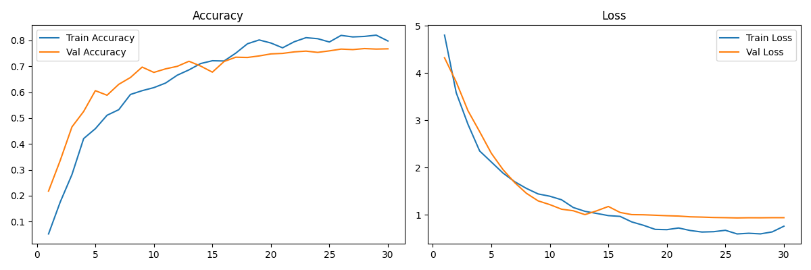
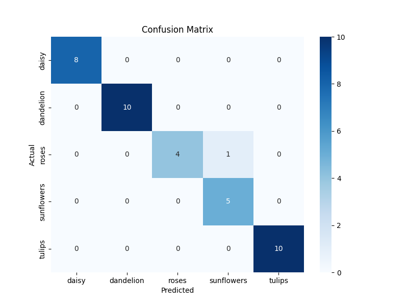

# 🌸 Flower Classifier

A full-stack app that identifies **102 flower species** from a single photo with **93.3% top-1 accuracy** on the 6,149-image Oxford 102 test set. A fine-tuned EfficientNetB5 served by a FastAPI inference API, with a React + TypeScript front-end, shipped as one Docker container.

**[▶ Live demo](https://huggingface.co/spaces/mgeorgiev5/Flower-Classifier)** · **[Model on Hugging Face](https://huggingface.co/mgeorgiev5/flower-classifier-model)**

<!-- Add a screenshot or GIF of the app, then uncomment the line below -->
<!--  -->

## Highlights

- **93.3% top-1 / 98.5% top-5 accuracy** on 6,149 held-out test images.
- **From 73.3% to 93.3%** through a series of measured experiments, each kept only if it helped (see [How I improved the model](#how-i-improved-the-model)).
- **End-to-end product:** model training, a FastAPI inference API, a React 19 + TypeScript UI, and deployment as a single container on Hugging Face Spaces.
- **Safe input handling:** uploads are validated on client and server (type, size, dimensions) and processed in memory, never written to disk.

## Results

Oxford 102 test split, 6,149 images:

| Metric                                    | Value      |
| ----------------------------------------- | ---------- |
| Top-1 accuracy                            | **93.27%** |
| Top-5 accuracy                            | 98.47%     |
| Balanced accuracy (mean per-class recall) | 94.0%      |

The final model was trained on the train and validation splits combined (2,040 images, 20 per species).




## How I improved the model

The first version reached 73.3%. I then changed one thing at a time and kept each change only if accuracy improved:

| Change                                                                           | Test top-1 |
| -------------------------------------------------------------------------------- | ---------- |
| Baseline (original setup)                                                        | 73.3%      |
| Keep BatchNorm layers in inference mode during fine-tuning                       | 75.8%      |
| Realistic data augmentation                                                      | 79.7%      |
| Linear classification head + label smoothing                                     | 80.1%      |
| Aspect-preserving resize + center crop                                           | 82.0%      |
| Fine-tune EfficientNet blocks 6–7 with AdamW and a cosine learning-rate schedule | 86.4%      |
| Mixup                                                                            | 86.7%      |
| Final run on train + validation                                                  | **93.3%**  |

The biggest lessons: small preprocessing details (BatchNorm behaviour, resizing without distorting the image) matter as much as the model itself, and with only 10–20 images per species, more training data gave the largest single jump.

> **Note on methodology:** the intermediate numbers above were measured on the test split during development, so the final 93.3% may be slightly optimistic. A stricter protocol would make every decision on the validation split only and use the test split once at the end.

## How it works

**Model.** EfficientNetB5 pretrained on ImageNet, with a linear classification head for 102 classes. Training runs in two phases: first the head only (backbone frozen), then fine-tuning EfficientNet blocks 6–7 with AdamW and a cosine learning-rate schedule. Label smoothing and mixup reduce overfitting on the small dataset.

**Preprocessing.** The model takes raw RGB pixels in the 0–255 range (EfficientNet normalizes internally). Images are resized so the shorter side is 300 px (antialiased), then center-cropped to 300×300.

**App.** The FastAPI back-end loads the model once at startup and exposes a prediction endpoint. The React front-end is a simple state machine (idle → preview → loading → result) with drag-and-drop upload and a typed API client. In production, one Docker container builds the front-end and serves it together with the API.

## Tech stack

| Area             | Tools                                                                                 |
| ---------------- | ------------------------------------------------------------------------------------- |
| Machine learning | TensorFlow 2.13, Keras, EfficientNetB5 (ImageNet weights), tensorflow-datasets, NumPy |
| Back-end         | FastAPI, Pydantic, Pillow                                                             |
| Front-end        | React 19, TypeScript, Vite                                                            |
| Deployment       | Docker, Hugging Face Spaces                                                           |

## API

**`POST /predict`** classifies an image sent as `multipart/form-data` in the field `file`. Accepts JPEG, PNG and WEBP up to 5 MB and 8000×8000 px.

```json
{ "flower": "sunflower", "confidence": 97.43 }
```

| Code  | Reason                                                        |
| ----- | ------------------------------------------------------------- |
| `413` | File larger than 5 MB                                         |
| `422` | Unsupported or unreadable file, or image dimensions too large |

**`GET /health`** returns `{ "status": "ok" }`.

Interactive API docs are available at `/docs` when the server is running.

## Run locally

Requires Python 3.10+ and Node.js 18+. Download the trained model from [Hugging Face](https://huggingface.co/mgeorgiev5/flower-classifier-model) and place it at the path set in `config.py`.

```bash
# Back-end
python -m venv venv
source venv/bin/activate          # Windows: venv\Scripts\activate
pip install -r requirements.txt
PYTHONPATH=. uvicorn api.main:app --port 8000 --reload

# Front-end (in a second terminal)
cd frontend
npm install
npm run dev
```

Open `http://localhost:5173`. The Vite dev server forwards API calls to the back-end, so no CORS setup is needed.

To retrain the model from scratch, run `python main.py`. It downloads the dataset, trains both phases, saves the best model, and writes `training_curves.png` and `confusion_matrix.png`. Hyperparameters are in `config.py`.

## Deployment

The `Dockerfile` builds the React front-end, installs the Python dependencies, and starts FastAPI on port 7860, serving the API and the static front-end from one process. Pushing to the Hugging Face Space rebuilds and redeploys it automatically:

```bash
git remote add space https://huggingface.co/spaces/mgeorgiev5/Flower-Classifier
git push space main
```

## Project structure

```
├── api/
│   ├── main.py              # FastAPI app, loads the model at startup
│   └── routes/predict.py    # POST /predict, GET /health, input validation
├── frontend/src/
│   ├── App.tsx              # UI state machine
│   ├── api/client.ts        # Typed API client
│   └── components/          # DropZone, ResultCard
├── src/
│   ├── data_loader.py       # Dataset pipeline and preprocessing
│   ├── model.py             # EfficientNetB5 model definition
│   ├── train.py             # Two-phase training
│   ├── evaluate.py          # Metrics, training curves, confusion matrix
│   └── predict.py           # Inference, shared by the API and tests
├── config.py                # Hyperparameters and paths
├── main.py                  # Training entry point
└── Dockerfile
```

## Limitations

- **Only 102 species.** The model knows only the dataset's flowers, which are common in the United Kingdom. Any other flower gets a confident but wrong answer from this list.
- **No "not a flower" class.** A photo of a dog or a car still gets a flower name.
- **Lower confidence values.** Because of label smoothing, scores are lower than in typical classifiers; 85% is already a confident prediction.
- **Look-alike species.** Some pairs are still confused, such as rose and camellia, or petunia and morning glory.

## Dataset

[Oxford 102 Flower Categories](https://www.tensorflow.org/datasets/catalog/oxford_flowers102): 8,189 images of 102 species, split into train (1,020), validation (1,020) and test (6,149).

## License

MIT
